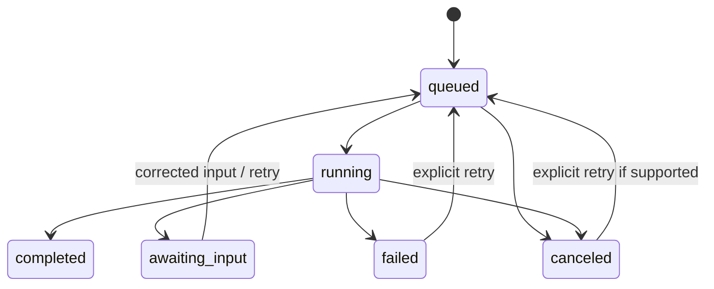

# Investor Hunter

## Purpose and current boundary

Investor Hunter researches potential buyers **outside the existing CRM** for a specific property. Buyer Matchmaker separately searches known authorized buyers. The initial provider, `synthetic-fixtures-v1`, contains 12 distinct explicitly fictional candidates. Requests accept counts from 1 to 100, but requests above 12 return only the 12 available fixtures. Phone numbers and source URLs are null, not fabricated. The full job and review pipeline is real; its candidates and evidence are fictional and must never be used as real leads.

A target count is a maximum requested output, not a promise of verified coverage. The system should return fewer prospects when evidence is insufficient rather than invent records. The founder’s reported research advantage is not independently validated.

## Pipeline

1. **Validate the subject.** Require address, county, price, strategy and count; accept an optional property type for similarity scoring. Identify missing location/property attributes before live research. The demo accepts employee input without pretending to have resolved the parcel.
2. **Discover external activity.** A provider retrieves licensed transactions or lawfully accessible professional sources. Store source identity, observation date, transaction date when known, source URL/record ID and limitations.
3. **Resolve entities.** Normalize entity names and addresses. Keep LLC/company attribution separate from a human contact. Do not infer an individual’s ownership solely from a matching surname or address.
4. **Assess fit.** Calculate transparent relevance factors against the subject property. Store every factor and its contribution, and keep unknowns visible.
5. **Check CRM duplicates.** Compare authorized CRM entities and contact identifiers, retaining exact, possible and uncertain outcomes. The local private duplicate service also compares protected same-organization records, returning only an opaque possible-duplicate flag with no matched ID. Production needs customer-approved identity and duplicate rules; hidden records are never disclosed.
6. **Review contacts.** Keep missing/unverified/verified status and source. The demonstration uses missing contacts; no invented phone numbers.
7. **Deliver artifacts.** Persist ranked results, evidence, filterable status and CSV. Prepare selected candidates for review as a stored CRM import action.
8. **Execute only after approval.** Recheck current duplicate and scope state before creating local records. Preserve an audit trail and safe repeated approval behavior.

## Data contract

`ResearchInput`: address, county, price, strategy, optional property type, limit. `ResearchJob`: ID, input, owner, provider, status, stage, progress, attempts, result list, error and creation/update timestamps. `Prospect`: entity/name, county, strategy, typical purchase price, transaction count, last activity, score, factor contributions, rationale, duplicate class, optional matched record, contact status, evidence and synthetic flag.

Every evidence item has an ID, title, nullable URL, observation timestamp, detail and synthetic flag; transaction evidence may include the compared property type. A missing URL or phone is explicitly missing; placeholder URLs/numbers must not imply verification. Production evidence should also capture provider record keys, retrieved-at versus transaction-at, licensing/retention constraints and source revision/hash.

## Explainable scoring

`scoreProspect` in `src/server/research.ts` accepts configurable nonnegative weights with a positive total. Default weights total 100:

| Factor | Weight | Implemented baseline |
| --- | ---: | --- |
| Property type | 25 | Known normalized type equality; missing input/evidence contributes zero |
| Geography | 10 | County equality after case/space/“County” suffix normalization receives 1.0; other counties 0.25 |
| Strategy | 20 | Normalized strategy aliases match at 1.0; “both” matches either supported strategy; another strategy receives 0.25 |
| Price | 25 | `max(0, 1 - abs(typicalPrice - subjectPrice) / subjectPrice)` |
| Recency | 10 | Linear decay across 365 days; invalid or future activity dates receive zero |
| Activity | 5 | Transaction count / 8, capped at 1 |
| Evidence | 5 | Evidence item count / 2, capped at 1 |

Each factor is multiplied by its normalized weight; contributions are rounded to tenths and the total to an integer from 0 to 100. Evidence count is a simple demo signal, not an assessment of source independence or reliability. These formulas are deterministic and inspectable, not claims of empirically calibrated predictive quality.

County match is coarse geographic relevance, not measured parcel distance. Purchase-price similarity is not a financing qualification. Recency decays with age; future or invalid activity dates must not receive unwarranted confidence. Missing information must not be treated as a match. Research relevance does not imply purchase intent, investor quality, loan approval or guaranteed returns.

Before live pilot use, calibrate weights against a labeled sample of relevant and irrelevant buyers. Report missingness and review false positives. Property type now contributes when supplied, with aliases such as SFR/single-family and condo/condominium. Rehab similarity and source reliability grading remain future work. Demo transaction types are explicitly fictional. Property type plus price account for 50 points, reflecting Alex’s reported preference for comparable prior purchases; this weighting is a product choice, not a verified corporate rule.

## Duplicate classes

| State | Interpretation | Import behavior |
| --- | --- | --- |
| `net_new` | No match in visible or privacy-checked same-organization records under current rules | Eligible for proposal, subject to execution-time recheck |
| `existing` | Strong match to existing allowed CRM record | Do not create another record |
| `possible_duplicate` | Similar permitted entity evidence, or opaque protected same-organization match with no ID | Review before import; never silently merge |
| `uncertain` | Identity evidence insufficient | Hold for identity review |

A `net_new` label in demo scope means no match in fictional same-organization records under the implemented rules, not proof of absence from all New Western systems. Research results refresh duplicate status when read, and import execution rechecks after any intervening local changes. The Jordan-owned Cedar & Stone fixture demonstrates an opaque private collision; Alex cannot retrieve its record details.

## Job lifecycle

Persist progress at meaningful stage boundaries. A canceled job must not later overwrite itself as completed. Stale worker leases allow recovery after a crash. Retries increment attempts and retain enough failure context for diagnosis. Job completion creates an in-app notification and usage event. A stopped server cannot execute work, but persistence preserves it for restart.

## Provider abstraction and selection

The runtime provider accepts a subject and bounded research request, and returns normalized candidates with evidence. Adapters must handle authorization, request limits, pagination, cancellation, timeouts, explicit no-result responses and provider errors. Provider credentials belong to server-side tenant configuration, never browser forms or model prompts. `ResearchProvider` permits asynchronous discovery, but the current local job executor invokes only the synchronous synthetic provider; a live adapter must also move network I/O outside long SQLite write transactions and implement result checkpointing.

| Candidate provider | Appropriate role | Open questions before implementation |
| --- | --- | --- |
| ATTOM | Property characteristics and transaction/ownership data, subject to licensed products | Georgia deed freshness, sold-price coverage, entity identifiers, retention and commercial rights |
| Regrid | Parcel/ownership context and authoritative field schema | Selected parcel/ownership tiers, transfer data coverage and licensing terms |
| OpenAI web search | Cited public company/professional research and source discovery | Entity verification procedure, cost budgets, source quality and storage policy |
| County/corporate sources | Primary evidence where lawfully accessible | Automated access permission, coverage, available APIs and freshness |
| Contact provider | Licensed business contact verification | Provenance, association accuracy, consent/Do-Not-Call and permitted reuse |

ATTOM documents API-key authentication and property endpoints; Regrid offers authenticated schema discovery for parcel and ownership fields. These capabilities do not alone establish that a provider supplies verified business phone numbers or cash-buyer intent. [ATTOM developer guide](https://api.developer.attomdata.com/docs/guides), [Regrid schema endpoints](https://support.regrid.com/docs/schema-endpoints).

OpenAI web-search responses expose cited URL annotations; a production UI must preserve clear clickable citations rather than converting model prose into unsourced evidence. Search findings still need entity/transaction validation. [OpenAI web search output](https://developers.openai.com/api/docs/guides/tools-web-search#output-and-citations).

## Pilot research quality gate

Select one authorized Georgia property and produce a human-reviewed evidence sample before outreach. Verify identity, relevant acquisition examples, business contact association, duplicate status and source rights. Track requested candidates, candidates found, supported candidates, contact availability, duplicate exclusions and review corrections. Do not claim a genuine researched example exists until it has actually been prepared and verified.
