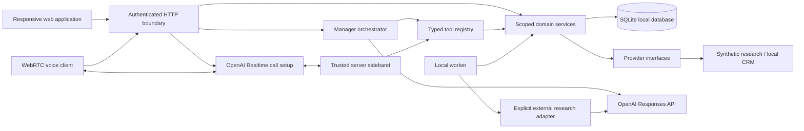

# System architecture

**Document role:** architecture specification; [IMPLEMENTATION_ROADMAP.md](IMPLEMENTATION_ROADMAP.md) alone controls delivery status and sequencing. The October 30 new-opportunity intake slice extends saved-question checkpoint `2555172` and has local integrated acceptance. Installed-phone and live-provider acceptance remain pending.

## Native client and shared command transport

The `mobile/` Expo/React Native project has an independent dependency graph and Node version, reusing shared contracts, pure client-safe intake form helpers and the existing API. Metro watches only the shared `src/lib` directory for these runtime helper imports; it does not use the root dependency graph. It does not move server secrets, SQLite or agent execution to the phone. `mobile-auth.ts` pairs a single-use code from a signed-in fictional employee with a revocable hashed bearer credential. Current membership/role is rechecked; native requests cannot switch demonstration persona or issue another device code. Existing browser cookie/origin controls remain unchanged for browser requests. Explicit private development origins are separate from the canonical hosted HTTPS origin. This is demonstration device access, not company SSO.

`work-conversation.ts` handles actual employee work commands before model execution, with scoped command receipts and immutable cost reviews. The same ongoing conversation connects native/web/SMS and retained Slack transport. `mobile-notifications.ts` queues generic job notices after device opt-in, rechecks session/source access, separates Expo acceptance/receipt from phone display, and retains unknown send outcomes without automatic retry. A separate worker timer avoids delaying jobs on notification delivery. Live push defaults off.

`mobile/src/InboxScreen.tsx` uses existing scoped inbox services over the same authenticated client; `inbox-editor.ts` keeps dirty text tied to its original expected version until explicit comparison. Source changes reset protected editors/reviews. Stable operation IDs support explicit retry while the screen remains active. Native Agent links open Inbox without duplicating the assistant conversation. All private rendered state is cleared on backgrounding; unsaved editors/pending UI state are not persisted offline. No migration or native dependency was added for Inbox.

`WorkHome` separates personal follow-ups, durable jobs and role-scoped Intake. `task-context.ts` decorates an owner-only personal task with a currently authorized source link without expanding mailbox access. Existing task mutations retain version/replay checks. `acquisitions.ts` adds supplied wholesaler statements to existing versioned releases and derives sourced questions/changes/internal handoff; it does not create a second release store. The existing `review_handoff` capability uses this service. Current property, release and method versions invalidate stale saved work displays and protected conversation replay. See [acquisitions intake](ACQUISITIONS_INTAKE.md).

`handoffs.ts` implements shared operational coordination independently of private correspondence and reminders. Manager and assignee projections recheck current release access. Migration 025 adds current records and immutable decision events. Typed/read-only Copilot, office-priorities work and web voice use the same current board fingerprint; saved history/work provenance masks obsolete results. Native `HandoffsScreen` and desktop `HandoffsPanel` use explicit reviewed mutations. See [MANAGEMENT_HANDOFFS.md](MANAGEMENT_HANDOFFS.md).

`opportunities.ts` adds pre-inventory wholesaler intake separately from inventory/releases. Migration 026 stores owner/office-scoped opportunities and immutable revision events. Preview receipts bind input, current version and authorized duplicate evidence; reviewed writes recheck them transactionally and preserve exact retries. Opportunity references participate in conversation/model/voice context and saved-work provenance. `OpportunitiesPanel` and native `OpportunitiesScreen` share this API; the read-only Copilot tool and deterministic `review_opportunity` capability use the same assessment. Source references remain text, not fetched evidence.

## Saved questions

`work-questions.ts` projects source-bound questions and validates employee-supplied answers; its schema is separate to avoid a native ESM dependency cycle. `request_information` is a zero-cost capability whose completion is only available to the authenticated answer service. Existing job/plan JSON and immutable step receipts persist continuation without a migration. Answers preserve prior work, create a fresh whole-job quote and invalidate prior cost decisions. Current question/choice references protect saved history and derived work context; answered questions stay readable while their original sources remain current. Desktop and native Work share the same API. See [the continuation contract](WORK_EXECUTION.md#saved-questions-and-continuation).

## Durable local execution layer

The verified bounded [shared-work foundation](IMPLEMENTATION_ROADMAP.md#c1--shared-conversation-and-work-controls) (legacy A1–A3) implementation adds private work runs, immutable versioned plans, steps/dependencies, events, leases and transactional receipts around existing domain services. `work-capabilities.ts` defines ten typed local capabilities; Copilot composes these through `start_work`, and Work queue offers role starters and pause/resume/cancel/exact cost decisions. `work-budget.ts` owns the fictional whole-job quote, hold and partial settlement, including child synthetic research. Original model context and immutable plan references are rechecked on execution, display and chat replay. See [WORK_EXECUTION.md](WORK_EXECUTION.md). The worker performs no additional model calls, real research or sending. Bounded conversational controls have local integrated acceptance; broader continuation, automatic top-up and real provider cost integration remain pending. Roadmap C4–C7 add source/versioned methods, linked deal/party/document context, scheduling and tested standing action authority. Every surface reuses current scoped services and authoritative receipts.

## Company-email demonstration — communications Phase 4A

The common correspondence contract now includes fictional `salesforce` accounts alongside preserved `gmail`, `outlook` and `twilio` accounts. `communications-capabilities.ts` derives body/history/local-draft/simulated-send availability from source coverage, access state and transport; attachment files remain unavailable. The primary company account supports full fictional correspondence and reviewed simulation. Captured activity allows reading and local drafts without sending; headers-only records cannot support body-derived replies or journey changes. `InboxSources.tsx` presents those limits without claiming a live connection.

Migration 018 adds separate company seed markers and scoped immutable source links. A server-owned correlation example attaches a second origin to one existing message without creating a duplicate message or action. Account access revisions participate in protected context and review hashes; Copilot history and cached tool results recheck saved access references. Revocation masks source content and blocks actions before replay, while restoration requires fresh review. Company-specific typed Copilot requests and linked employee channels call these same services. See [COMPANY_EMAIL_DEMO.md](COMPANY_EMAIL_DEMO.md).

Live Phase 4B remains subject to administrator discovery in [SALESFORCE_INTEGRATION.md](SALESFORCE_INTEGRATION.md). No company mailbox, Salesforce organization, synchronization or live sending adapter is connected. Company CRM visibility still does not grant access to an employee’s private mailbox.

## Unified inbox and Copilot — communications Phases 2–3

The private correspondence domain uses `communications.ts`, `communications-workflow.ts`, `communications-api.ts`, additive inbox/workflow migrations and `communications-contracts.ts`. Fictional Gmail, Outlook and business-text sources normalize to private accounts/threads/messages/drafts, independent of assistant chat and employee channel delivery. Typed Copilot tools call the same scoped assistance and draft services as the UI. Exact review, simulated delivery, reviewed journey observations and follow-ups use explicit employee API actions. The model cannot approve them. Private inbox fingerprints and history references invalidate stale assistant context; voice excludes inbox tools and inbox-derived history. There are no live adapters or background mailbox analysis. See COMMUNICATIONS_WORKFLOW.md and COMMUNICATIONS_INBOX.md.

## Communications and credits update — October 29, 2026

The workforce subscription and wallet simulator extend the same monolith. All implemented role-authorized specialists share one base plan. Company seats require explicit billing-admin assignment. The wallet has reviewed server-priced sample quotes, transactional holds/settlement and append-only history; it is separate from live provider admission/receipts until production cost reconciliation. See COMMUNICATIONS_AND_CREDITS_PLAN.md for email, investor inbox and dedicated number phases.

## Local implementation structure

The application is a modular monolith. Browser components receive shared contracts from `src/lib/contracts.ts`; they do not import persistence or integration credentials. `src/server` owns permission checks, domain state changes and integration execution. Next.js route handlers normalize transport details and errors.

Phase 2 extends this structure rather than replacing it. `intelligence-contracts.ts` holds profile, buy-box, release, package, debrief and calling contracts. `access.ts` enforces relationship ownership/sharing and opaque duplicate collisions. `intelligence.ts` owns reviewed buy boxes, disclosure evidence, matching, calling priorities and briefings. `workflows.ts` owns versioned releases, templates and eligible package review/handoff. `debrief.ts` turns employee recaps into source-backed proposals and explicitly requested tasks. `phase-two-api.ts` runs inside the existing authenticated, rate-limited request boundary. `channels.ts` is an older provider foundation; the implemented employee Slack/SMS adapter path uses the separate messaging services/worker described below. Actual account round-trip acceptance remains pending.

## Request lifecycle

1. Check the allowed local origin and demonstration configuration; validate the signed session.
2. Resolve actor identity from trusted server state, never a model-supplied organization or role.
3. Validate a bounded input schema and apply request limits.
4. Retrieve only permitted records and conversation history.
5. Execute a direct service operation or the Copilot’s bounded model/tool loop.
6. Recheck permissions at the domain service, including owner/office and referenced record scope.
7. Commit state and audit metadata transactionally where possible.
8. Return typed, provenance-aware results and persist the conversation outcome.

## Orchestrator

Copilot is a manager, not a handoff to a swarm of independent speakers. The Responses API exposes validated application functions. Tool responses include `specialistIds`, a message, optional structured data and artifact references. The assistant synthesizes only confirmed tool results. It cannot approve its own proposals.

Simple summaries of actual task/job state, duplicate checks, task creation and local record lookup use deterministic services. The optional model interprets natural language and coordinates these functions. Its loop has a fixed tool-call budget to limit runaway cost. The application retains its own conversation state rather than relying exclusively on provider-side memory.

Phase 4 separates `text-runtime.ts`, `provider-config.ts` and `provider-runtime.ts` from the domain dispatcher. The documented default model is `gpt-6-astra` with `high` reasoning, configurable through the supported effort enum. A text request defaults to five model rounds, eight tool calls, 8,000 output tokens and a 90-second per-request timeout. Limits are bounded configuration values. `store: false` retains state locally. The runtime validates response envelopes, preserves replayable reasoning/function/message groups and distinguishes final answers from commentary, refusals and incomplete responses. See `OPENAI_PROVIDER_REFERENCES.md` for current official API references and the rationale for retaining direct Responses instead of migrating the service layer to an SDK runner.

`assistant_turns` binds a stable request ID and payload hash to an authenticated organization/office/employee and conversation. An identical completed retry returns the saved, currently authorized display answer; conflicting reuse or interrupted execution cannot replay mutations. `assistant_tool_receipts` commits synchronous local service writes and their structured result in one transaction. Function call IDs cannot be reused with different arguments or a different turn. Consequential CRM updates still require the existing separate human approval flow.

`assistant_context` stores full provider history separately from user-visible messages. A fingerprint of current authorized context, capability decisions and relevant protected state invalidates opaque history when its assumptions change. Cached output is never returned directly around history redaction. Provider history is server-side sensitive data, not a client contract or permanent memory authority. Retention/deletion policies for a real-data deployment remain a production requirement.

The local fallback supports a narrower set of requests and is labeled as such. It is a useful offline demonstration of service execution, not an equivalent language model.

Phase 2 adds typed tools for the calling queue, pre-call briefing, property releases, recap capture, reviewable recap changes and package composition. Text and live voice use the same dispatch. Approval and package handoff are deliberately absent from the model tool registry: an employee reviews the exact result in the app. `compose_deal_package` applies the same disclosure/release/media checks as the composer screen. Offline example commands include “Who should I call today?”, “Get me ready to call Mike” and “I just talked to Mike…”; exact selections and nuanced changes remain available in workflow forms.

## Persistence and jobs

SQLite supports local transactions and foreign keys. Jobs store input, owner scope, status, progress, stage, attempts, timestamps, provider, result and errors. The worker claims eligible work and handles stale running jobs on recovery. Cancellation is checked before further progression; completed results remain inspectable. Job completion generates a deduplicated notification.

The standard launcher starts a separate worker process alongside Next.js; `npm run worker` also starts it independently. It checks pending work and advances eligible stages. Synthetic stages retain their short local processing cycle. External research claims durable work, performs provider requests outside SQLite transactions and rechecks entitlement/cancellation before recording or advancing results. An interrupted external request has an unknown outcome and is not silently repeated. A stopped laptop/server does not run work; persisted jobs are inspected on subsequent processing. This queue architecture is limited to a local single-machine deployment. PostgreSQL leasing or a queue such as Redis-backed workers will replace it for concurrent hosts.

Property release commands carry a source, explicit audience, unique event key and expected version. Successful commands create one persisted revision and per-employee notification; repeat keys with changed payloads are rejected. Matches are calculated for the requesting employee and are never stored with protected buyer identities in shared release data. Calling priorities are recalculated from current authorized state when requested. This is deterministic recomputation, not a continuously running autonomous calling agent. Revised/withdrawn releases invalidate old package content; package reads, approval and handoff recheck current evidence and permissions.

## Integration boundaries

| Boundary | Current local behavior | Production path |
| --- | --- | --- |
| CRM adapter | Authorized fictional buyer lookup and approved note/import mutations | Salesforce delegated OAuth, schema mappings, field access, replay protection |
| Research provider | Separate fictional provider and explicitly selected OpenAI web-search adapter; no live source run verified | Live evidence evaluation, licensed transactions, independent contact verification and source-rights review |
| Model provider | Bounded Responses manager, durable replay and provider/token receipts; limited live fictional rehearsals recorded in PROGRESS | Broader quality evaluation, job-wide cost admission, operational reconciliation and retention |
| Voice | WebRTC setup, trusted server sideband and receipt-driven tools/lifecycle; live audio unverified | Real microphone/audio trials, cost evaluation, multi-instance operation and production metering policy |
| Employee channels | Shared Copilot with implemented Slack/SMS identity linking, replay-safe ingress/outbox and mocked delivery acceptance | Actual account setup and verified real round-trips |
| Investor correspondence | Private fictional Salesforce/Gmail/Outlook/text inbox, typed Copilot search/read/assistance, exact generated-reply simulation and reviewed relationship association | General edited sends, files/CC, approved live sync/transport, dedicated investor numbers and delivery reconciliation |
| Knowledge | Baseline fixture guidance | Approved document revisions and permission-aware retrieval |

## Trust and memory boundaries

Employee context, business records, procedure knowledge and execution history are separate categories. Model hypotheses do not become verified CRM facts. Transcript text and retrieved documents cannot change system instructions, tools, access scopes or approval state. Explicit employee preferences with inspect/correct/forget controls, sourced investor observations and structured report/correction ledgers are implemented. Broader reviewable learning from edits and versioned SOP retrieval remain future work; conversation history does not automatically become authoritative memory.

`provider_operations` records scoped request and response identifiers, status, model and available numeric usage independently of `billing_usage`. Actual provider cost remains null when unknown. Text admission reserves a conservative budget including tools, then reconciles authoritative token totals even if they exceed the estimate. A missing/invalid receipt remains unresolved and reserved; a timeout does not establish that the provider spent nothing. The ledger supports later receipts without granting new capability access. Subscription invoices remain simulated and do not collect money.

External research sends property criteria and prior public candidate names, not private CRM records, to the provider. A candidate URL must occur in returned web-search/citation metadata before becoming evidence. This proves a source reference was returned; it does not independently verify the page's claims, transaction, identity or phone association. Research estimates are explicit operator assumptions and admission limits, not provider-confirmed invoices or guaranteed hard spend caps.

## Production transition

Introduce managed OIDC/SSO and membership provisioning before real company-data access. The separately authorized hosted fictional demo uses its invitation gate and is not production employee identity. Move schema to PostgreSQL, enforce tenant relationships at the database layer, and test cross-tenant access independently. Deploy a separately supervised queue worker, migrations, backup/restore, secrets manager, structured redacted telemetry, provider rate/cost budgets and retention operations. Do not deploy the local demo role switcher.

## Investor understanding projection

`src/server/relationship-record.ts` projects reviewed criteria and immutable employee reports into typed facts, differing-source questions, provisional reconfirmation flags and correction history. `relationship-record-contracts.ts` is the shared browser/server boundary. `GET /api/investors/:id/relationship-record` reads it; `POST /api/investors/:id/relationship-record/reports` validates and appends a reviewed employee report. Both use the existing authenticated/request-protected route and shared authorization services.

Journey, recommendation, Inbox assistance and the existing Copilot journey tool reuse that projection. Saved relationship reports participate in protected model-context fingerprints and inbox review hashes; volatile generation timestamps do not create false stale reviews. Copilot has no report-write/approval tool. Comparison and recommendations remain deterministic.

`relationship-methods.ts` supplies code-reviewed provisional qualification/objection/reactivation/follow-through methods with source, revision, effective date, role and withdrawal semantics. The newest effective version is selected before checking withdrawal/role, preventing fallback to superseded advice. `relationship-method-contracts.ts` shares the method, useful question, checks, evidence references and missing facts across native/web/Copilot. Exact send-review and active model-context fingerprints include the catalog hash. No company knowledge ingestion/publishing, automatic CRM change or extra model call follows from a method. Wider knowledge lifecycle, deeper reasoning and equal-context model evaluations remain later C4/C7 work.
