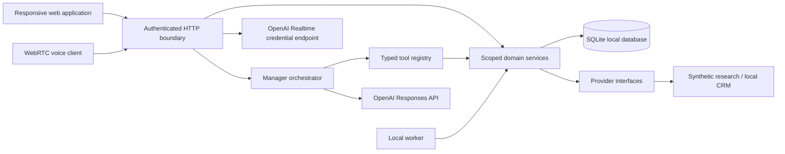

# System architecture

## Local implementation structure

The application is a modular monolith. Browser components receive shared contracts from `src/lib/contracts.ts`; they do not import persistence or integration credentials. `src/server` owns permission checks, domain state changes and integration execution. Next.js route handlers normalize transport details and errors.

## Request lifecycle

1. Check the allowed local origin and demonstration configuration; validate the signed session.
2. Resolve actor identity from trusted server state, never a model-supplied organization or role.
3. Validate a bounded input schema and apply request limits.
4. Retrieve only permitted records and conversation history.
5. Execute a direct service operation or the Copilot’s bounded model/tool loop.
6. Recheck permissions at the domain service, including owner/office and referenced record scope.
7. Commit state and audit metadata transactionally where possible.
8. Return typed, provenance-aware results and persist the conversation outcome.

## Orchestrator

Copilot is a manager, not a handoff to a swarm of independent speakers. The Responses API exposes validated application functions. Tool responses include `specialistIds`, a message, optional structured data and artifact references. The assistant synthesizes only confirmed tool results. It cannot approve its own proposals.

Simple summaries of actual task/job state, duplicate checks, task creation and local record lookup use deterministic services. The optional model interprets natural language and coordinates these functions. Its loop has a fixed tool-call budget to limit runaway cost. The application retains its own conversation state rather than relying exclusively on provider-side memory.

The local fallback supports a narrower set of requests and is labeled as such. It is a useful offline demonstration of service execution, not an equivalent language model.

## Persistence and jobs

SQLite supports local transactions and foreign keys. Jobs store input, owner scope, status, progress, stage, attempts, timestamps, provider, result and errors. The worker claims eligible work and handles stale running jobs on recovery. Cancellation is checked before further progression; completed results remain inspectable. Job completion generates a deduplicated notification.

The standard launcher starts a separate worker process alongside Next.js; `npm run worker` also starts it independently. It checks pending work every two seconds and advances one stage per eligible job. SQLite transactions claim stages with a 30-second lease, with a one-second delay between stages. A stopped laptop/server does not run work; persisted jobs resume on subsequent processing. This queue architecture is limited to a local single-machine deployment. PostgreSQL leasing or a queue such as Redis-backed workers will replace it for concurrent hosts.

## Integration boundaries

| Boundary | Current local behavior | Production path |
| --- | --- | --- |
| CRM adapter | Authorized fictional buyer lookup and approved note/import mutations | Salesforce delegated OAuth, schema mappings, field access, replay protection |
| Research provider | Deterministic synthetic candidates and evidence | Licensed transaction/parcel APIs plus cited public professional research |
| Model provider | Responses API if configured | Project-scoped credentials, evaluated model selection, quotas and budgets |
| Voice | Authenticated short-lived credential and browser WebRTC | Live quality testing, sideband/server attestation, production metering |
| Channels | Web is operational surface; channel design documented | Verified external identity links and replay-safe webhooks |
| Knowledge | Baseline fixture guidance | Approved document revisions and permission-aware retrieval |

## Trust and memory boundaries

Employee context, business records, procedure knowledge and execution history are separate categories. Model hypotheses do not become verified CRM facts. Transcript text and retrieved documents cannot change system instructions, tools, access scopes or approval state. Long-term approved-memory promotion and versioned SOP retrieval are future work; current persistence consists of messages and domain records.

## Production transition

Introduce managed OIDC/SSO and membership provisioning before remote exposure. Move schema to PostgreSQL, enforce tenant relationships at the database layer, and test cross-tenant access independently. Deploy a separately supervised queue worker, migrations, backup/restore, secrets manager, structured redacted telemetry, provider rate/cost budgets and retention operations. Do not deploy the local demo role switcher.
